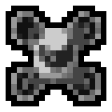
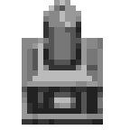
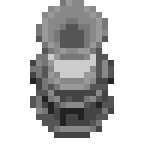
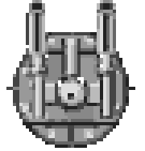
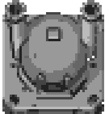

# G2TD: Tower Defense: phone guide

<!-- The phone Guide as it shows now (src/phone.ts, guide()), with today's numbers filled in.
     Edit the words freely; the numbers come from the rules (rules.ts, maps.json), so they
     will stay live when the text goes back into phone.ts. The opening line follows the map
     being played (this is map 1). -->

Hold the base for 5 waves. You start with $200 and 20 lives; build between waves, and anything you build can be taken back for a full refund until the next wave starts.

## Gameplay

Fight off the bot invasion through 5 levels, then confront the boss at the airlock.
- Each level is 5 waves, with more and stronger enemies
- Earn money for towers by defeating enemies and clearing waves
- Recover 5 lives by clearing a level. 
- Progress is auto-saved
- Choose any campaing level, or a randomized map from the menu

## Controls

Swipe to select tower locations along the path, tap to place. Long press to open the menu. 

## Enemies

### Walker

- Health: 4
- Bonus: +$2
- Damage: −1♥

Fast, numerous, Walkers try to overwhelm your defenses by sheer number. On the 4th wave they will swarm.

### Drone

- Health: 10
- Bonus: +$5
- Damage: −2♥

Slow and strong, the Drone has a shield that can take one hit from any tower. Drones always appear on the 2nd wave.

## Towers

### Laser

- Cost: $40
- Damage: 12
- Fire Rate: 1x
- Range: 2

A tripline across the path that its everything in both lanes. Has a cooldown every other step, so fast enemies may slip by.

### Stasis

- Cost: $35
- Damage: 0 - Slows enemies by 1/3 for 7 steps
- Fire Rate: 2x
- Range: 2

A tripline that slows enemies crossing it, in both lanes, so the next towers get more time on them. No damage, but passes through shields.

### Sniper

- Cost: $70
- Damage: 15
- Fire Rate: 1x
- Range: 4

Snipers can fire down long streches of the path, hitting one enemy at a time with a powerfull shot.

### Cannon

- Cost: $90
- Damage: 14 + Splash Damage
- Fire Rate: 1x
- Range: 2

Cannons fire a short-range explosive that hits all enemies around the target.

## The maps

1. Cargo Bay

2. Hab Ring

3. Regolith Mine

4. Reactor

5. Hydroponics

6. Airlock (Boss Battle)

